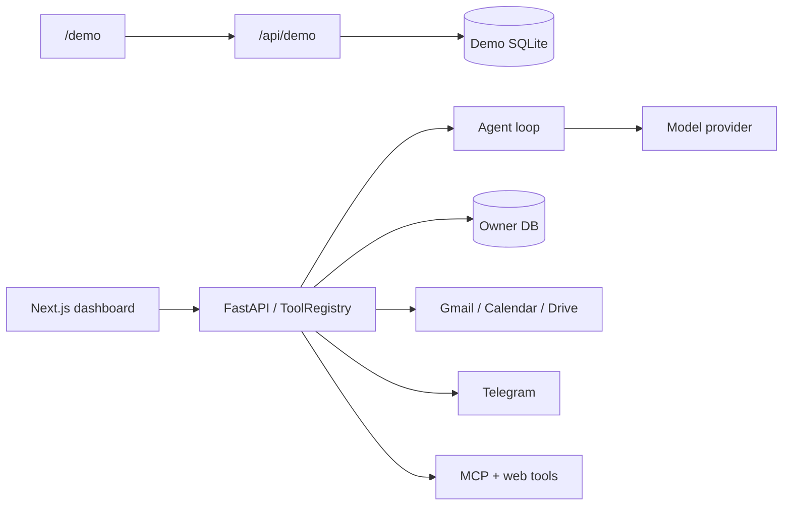

# AURA Personal AI Agent


**AURA is a safe-by-design personal chief of staff:** it reads, plans, and drafts on its own; anything that leaves your hands waits for one-tap approval; everything is logged and explainable.

[Try the demo](/demo) · [Feature status](docs/feature-status.md) · [v1.0 notes](docs/releases/v1.0.md)

> **60-second demo GIF** — placeholder: record Chat → approval card → Activity run steps and drop the file at `docs/demo.gif`.



## Why safe by design

Risky tools (`execute` / `destructive`) pause the run for durable approval. External email, Drive, and web content are labeled untrusted and never treated as instructions. Demo mode simulates outbound actions (`SIMULATED: …`) on a separate database.

## Working now

See the generated [feature status](docs/feature-status.md) (derived from
`frontend/lib/capabilities.ts` and checked in CI).

- Dashboard login, first-owner registration, logout; public [`/demo`](/demo) workspace.
- Agent chat with persistent history, live step trail, Stop button, and durable approvals.
- Today v2 / Chat v2, Inbox (approvals + suggestions), Goals & Plans, Routines,
  Calendar & Mail (AURA buckets), Memory tabs including Proposed, Activity, Help W1–W6.
- Appearance (light / dark / system) and Comfortable / Compact density; restored bell drawer.
- Agent control (autonomy presets, pause, budgets, quiet hours / proactive cap).
- Google OAuth tools, Telegram reply gate, MCP + web_search / web_fetch.
- Offline evals (25+ scenarios), tracing (`trace_id`), extended `/api/health`
  ([ADR 0010](docs/adr/0010-evals-and-lightweight-tracing.md),
  [ADR 0011](docs/adr/0011-isolated-demo-workspace.md)).

```text
backend/    Agent workflows, tools, auth, persistence, integrations, tests
frontend/   Next.js (App Router) + Tailwind dashboard
docs/       Architecture, deploy guide, ADRs, feature status, design notes
scripts/    Deploy helper, feature-status check, eval badge
```

## Five-command quick start

```bash
python3 -m venv backend/.venv && source backend/.venv/bin/activate
python -m pip install -e './backend[dev]'
cd backend && cp .env.example .env && personal-agent init-dashboard && alembic upgrade head
personal-agent dashboard          # http://127.0.0.1:8000
npm --prefix frontend ci && npm --prefix frontend run dev   # http://127.0.0.1:3000
```

Open `/demo` without registering, or register as the workspace owner and connect Telegram / Google under **Connections**.

## Deploy

Frontend on Vercel, API on Render, Postgres on Supabase, driven by GitHub Actions.
See [docs/deploy.md](docs/deploy.md).

## Guides

- [Contributing](CONTRIBUTING.md)
- [Architecture](docs/architecture.md) and [ADRs](docs/adr/)
- [Feature status](docs/feature-status.md)
- [Cloud deploy](docs/deploy.md)
- [v1.0 release notes](docs/releases/v1.0.md)

## Verification

```bash
# backend/
python -m pytest && ruff check . && ruff format --check .
# repo root
npm --prefix frontend run format:check && npm --prefix frontend run build
node scripts/check-feature-status.mjs
```
